<div align="center">

# 📘 manual-tecnico

**Convierte un concepto de desarrollo en un manual visual, listo para LinkedIn, TikTok e Instagram.**

Una skill de [Claude Code](https://claude.com/claude-code) de la comunidad [Chamba Lab](https://github.com/Chamba-Lab), con Rakim como mascota.

[Instalar](#-instálala-en-un-minuto) · [Copiar un prompt](#-prompts-listos-para-copiar) · [Ver ejemplos](#️-ejemplos) · [Licencia](#-licencia)

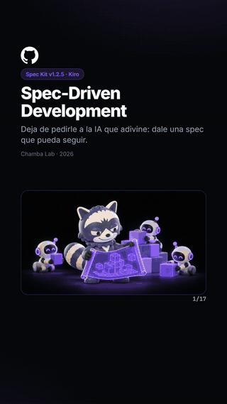

</div>

## ✨ Qué obtienes

Le pides un tema y recibes de 12 a 18 diapositivas que van del concepto al detalle, con el código comprobado contra la documentación oficial.

| Archivo | Para qué sirve | Formato |
|---|---|---|
| `manual.pdf` | Carrusel de LinkedIn. Es ligero: una imagen por página y enlaces clicables, pero sin texto seleccionable | 16:9 |
| `slides-9x16/` | TikTok e Instagram: `01.jpg`, `02.jpg`… | 1080×1920 |
| `portada-linkedin.png` | Imagen para anunciar el manual | 1:1 |
| `manual.html` | La fuente editable de todo lo anterior | HTML |

## 🚀 Instálala en un minuto

**Necesitas:** Claude Code, Node.js 18 o superior, internet y una cuenta de ChatGPT u otro generador de imágenes.

**1. Clona la skill**

```bash
git clone https://github.com/Chamba-Lab/manual-tecnico.git ~/.claude/skills/manual-tecnico
```

**2. Instala Playwright para exportar automáticamente**

```bash
npm i -g playwright
npx playwright install chromium
```

Sin Playwright, Claude te indica cómo sacar el PDF desde Chrome, pero no se generan las imágenes 9:16.

**3. Abre Claude Code en la carpeta de tus manuales y copia tu primer prompt**

```text
Arma un manual de Zustand
```

## 🧭 Cómo funciona

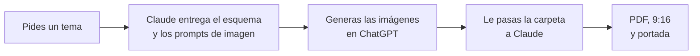

1. **Pides un tema.** Claude lo acota a un concepto, verifica la documentación y te entrega el esquema con 6 a 9 prompts de imagen.
2. **Generas las imágenes.** Pega los prompts en ChatGPT y guarda cada imagen con el nombre indicado, por ejemplo en `ZUSTAND/imagenes/`.
3. **Le pasas la carpeta a Claude.** Arma el manual, lo revisa y exporta todos los formatos.

¿Tienes prisa? Pídelo sin imágenes: esos huecos se ven como un degradado limpio y puedes agregar los archivos después.

<details>
<summary><b>🦝 Primera vez: deja a Rakim igual en todas las imágenes</b></summary>

<br>

En tu primer manual, Claude te dará un bloque con el estilo y la descripción de Rakim.

1. Crea en ChatGPT un proyecto llamado `Rakim · Manuales` y pega ese bloque en sus instrucciones.
2. Sube como archivos del proyecto las imágenes de `assets/personaje/`.
3. En cada chat nuevo, adjúntalas también en el primer mensaje.

Así cada prompt solo describe la escena.

</details>

## 📋 Prompts listos para copiar

Pasa el cursor sobre un bloque y usa el botón de copiar de GitHub. Cambia lo que está en `[corchetes]`.

**Crear un manual**

```text
Arma un manual de [tema] para desarrolladores junior y mid.
```

**Continuar cuando ya tienes las imágenes**

```text
Ya guardé las imágenes en [carpeta]/imagenes. Arma el manual y expórtalo.
```

<details>
<summary><b>Más prompts</b></summary>

<br>

**Sin esperar las imágenes**

```text
Arma ya el manual de [tema], sin imágenes. Las agregaré después.
```

**Con más precisión**

```text
Arma un manual de [tema] en [versión]. Usa como ejemplo [una tienda / una app de reservas].
Tema visual oscuro. El dolor principal es [error concreto que has sufrido].
```

**Solo los prompts de imagen**

```text
Dame solo el esquema y los prompts de imagen para un manual de [tema].
```

**Corregir un manual existente**

```text
En [carpeta]/manual.html, cambia [qué] en la diapositiva [número] y vuelve a exportar.
```

**Acortar para 9:16**

```text
La diapositiva [número] queda muy densa en 9:16. Acorta su texto solo en ese formato, sin cambiar el sentido.
```

**Regenerar solo los formatos**

```text
Exporta de nuevo [carpeta]/manual.html.
```

</details>

## 🖼️ Ejemplos

Estos ejemplos salen de un manual real sobre Spec-Driven Development. [Descarga el PDF completo](docs/ejemplos/spec-driven-ejemplo.pdf) (2,7 MB, 17 páginas).

**PDF para LinkedIn (16:9)**

<table>
<tr>
<td>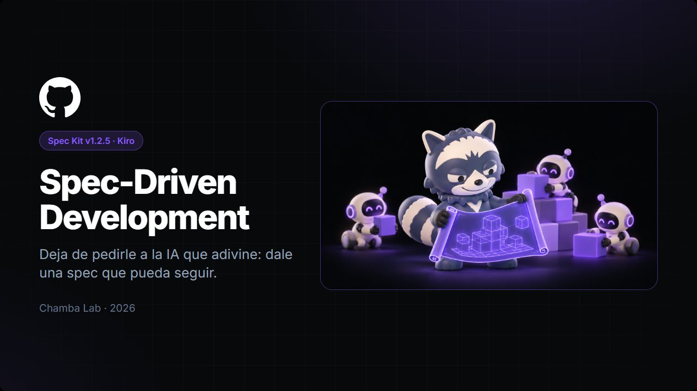</td>
<td>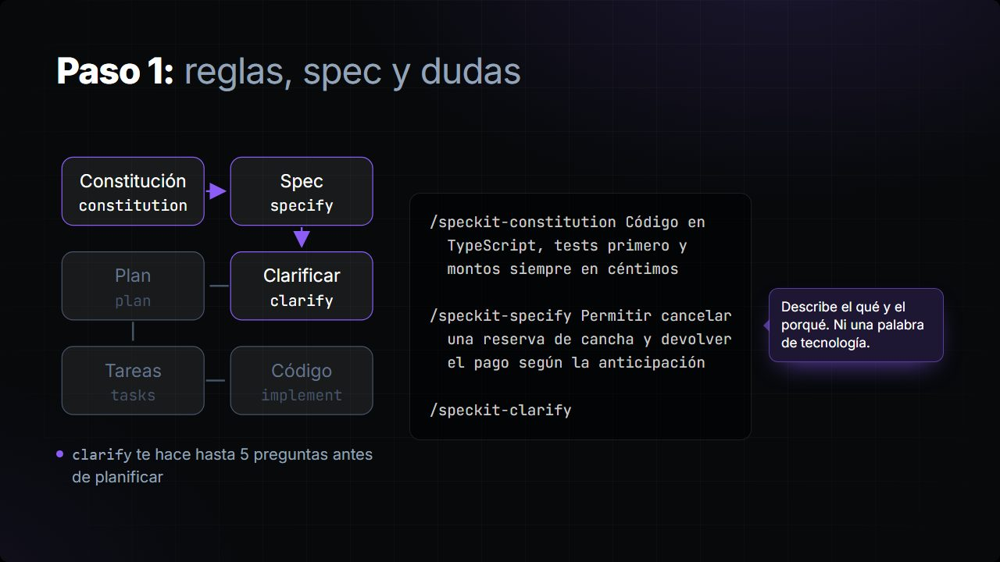</td>
<td>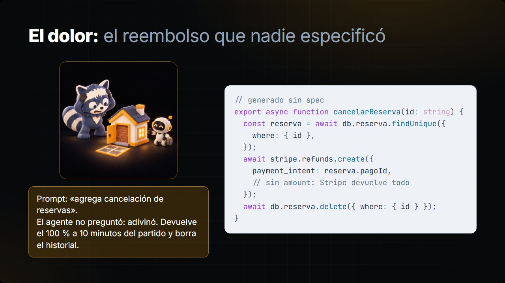</td>
</tr>
</table>

**Imágenes para TikTok e Instagram (9:16)**

La misma diapositiva se recompone en vertical; no se recorta.

<table>
<tr>
<td>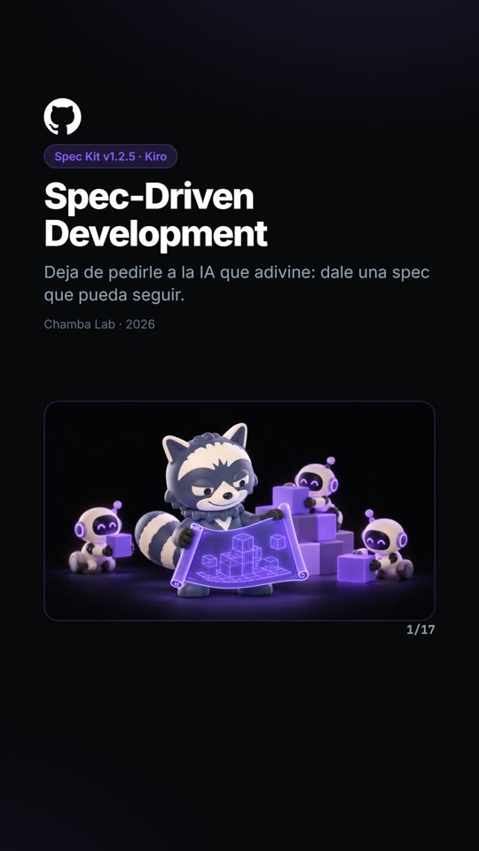</td>
<td>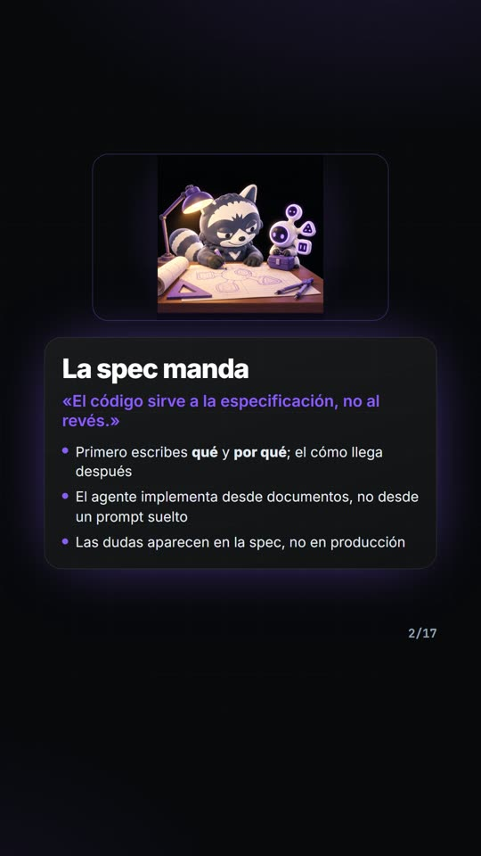</td>
<td>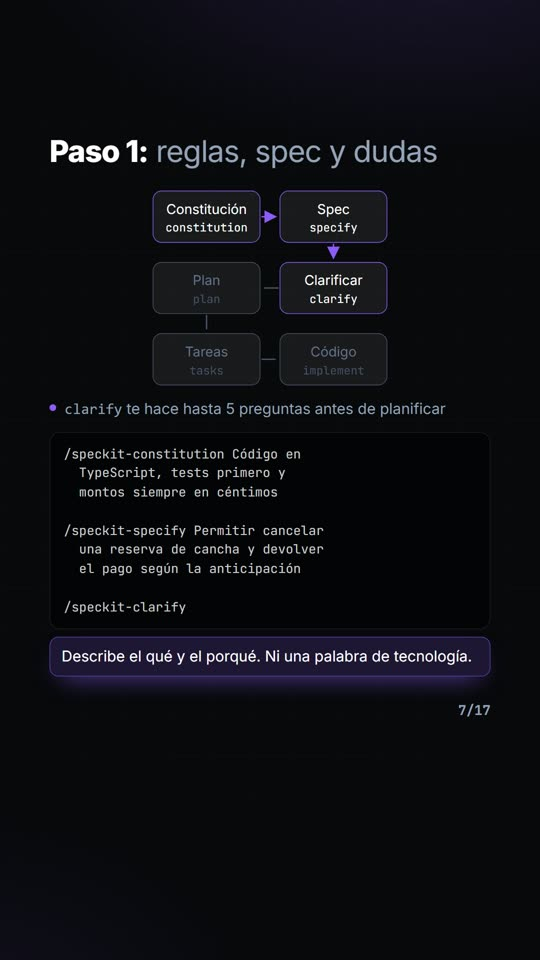</td>
<td>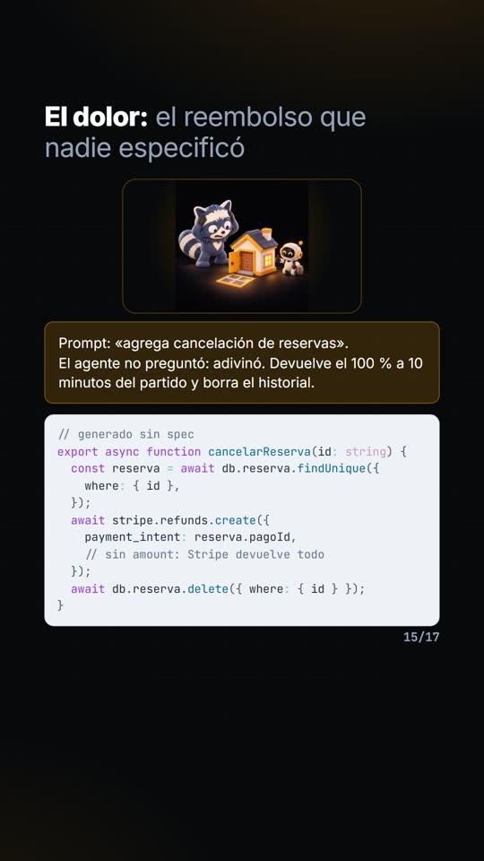</td>
<td>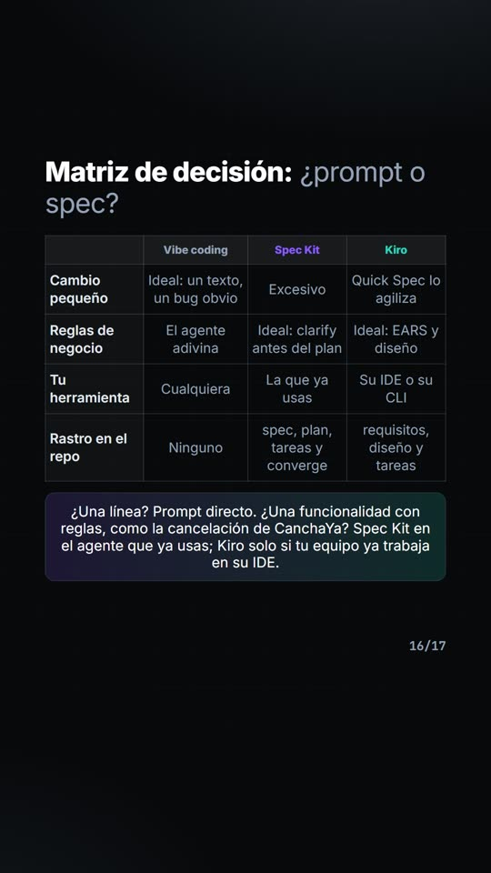</td>
</tr>
</table>

**Portada para LinkedIn (1:1)**

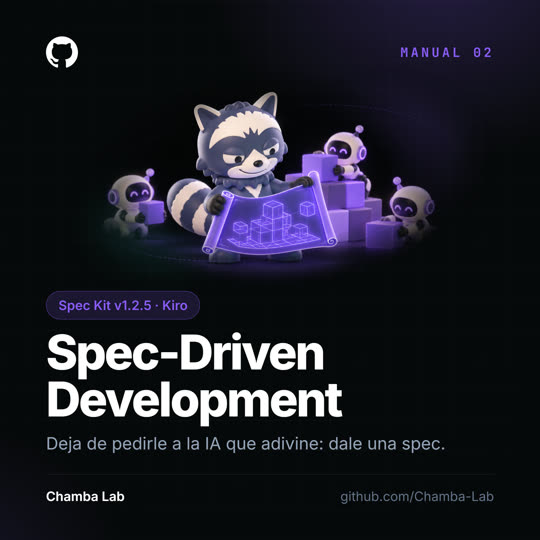

## 📲 Publicar

| Plataforma | Qué subir | Cómo |
|---|---|---|
| **LinkedIn** | `manual.pdf` | Como documento, con la portada para anunciarlo si quieres |
| **TikTok** | `slides-9x16/` | Selecciona varias fotos en una sola publicación, en orden |
| **Instagram** | `slides-9x16/` | Igual; mira la vista previa porque puede recortar arriba y abajo |

Revisa siempre la vista previa: las plataformas cambian sus formatos con frecuencia.

## ✅ Antes de publicar

- [ ] La portada muestra la tecnología con su versión.
- [ ] El código sigue funcionando con esa versión.
- [ ] Ninguna diapositiva se sale de la zona segura. Claude te avisa si ocurre.
- [ ] Las imágenes no llevan texto encima.
- [ ] El cierre enlaza a la documentación oficial.

<details>
<summary><b>🛠️ Problemas frecuentes</b></summary>

<br>

| Qué pasa | Qué hacer |
|---|---|
| No se generan PDF ni imágenes | Instala Playwright con los comandos de arriba |
| Falta una imagen | Se ve un degradado. Guarda el archivo con su nombre y exporta de nuevo |
| Las imágenes tienen otro nombre | Claude las renombra por orden de llegada y te muestra el cambio |
| Una diapositiva queda densa en 9:16 | Usa el prompt **Acortar para 9:16** |
| Quieres copiar texto del PDF | Copia desde `manual.html`: el PDF ligero no tiene texto seleccionable |

</details>

<details>
<summary><b>📁 Qué hay dentro</b></summary>

<br>

| Ruta | Qué es |
|---|---|
| `SKILL.md` | Instrucciones para Claude |
| `references/` | Arco, tema visual, prompts de imagen y diagramas |
| `assets/plantilla.html` | Sistema visual y tipos de diapositiva, en claro y oscuro |
| `assets/vertical.css` | Recomposición a 9:16 |
| `assets/portada-linkedin.html` | Portada cuadrada |
| `assets/personaje/` | Referencias de Rakim |
| `scripts/` | Ensamblar, traer logos, revisar y exportar |
| `docs/ejemplos/` | Las imágenes y el PDF de este README |

</details>

<details>
<summary><b>🎨 Adaptarla a tu marca</b></summary>

<br>

- **Firma:** cambia "Chamba Lab" y el enlace en *Marca de la serie*, dentro de `references/diseno.md`, y en las dos plantillas de `assets/`.
- **Mascota:** reemplaza las imágenes de `assets/personaje/` y la descripción `CHARACTER` en `references/imagenes.md`.

</details>

## 📄 Licencia

- **Código y documentación:** [MIT](LICENSE). Puedes usarlos, modificarlos y compartirlos, incluso con fines comerciales.
- **Rakim, la marca Chamba Lab y los ejemplos:** no están bajo MIT. Mira qué se permite en [NOTICE.md](NOTICE.md).
- **Logos de tecnologías:** pertenecen a sus dueños.
